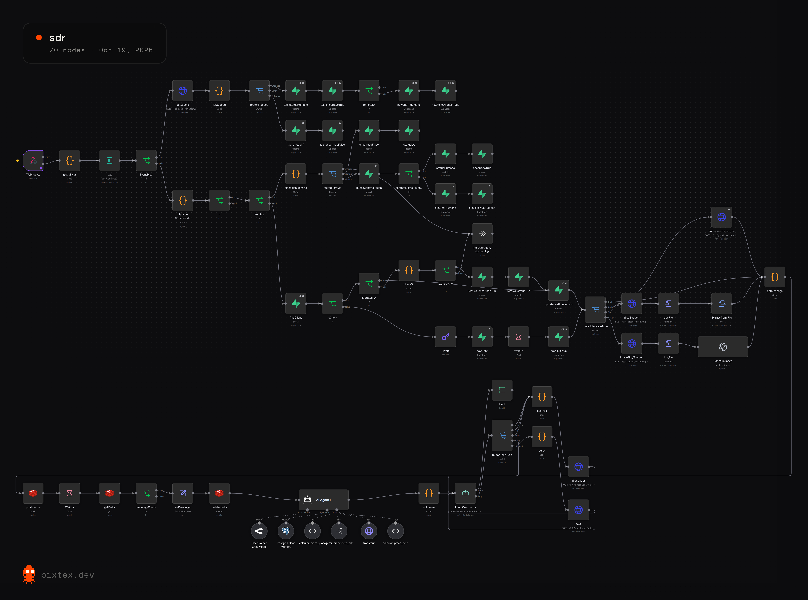
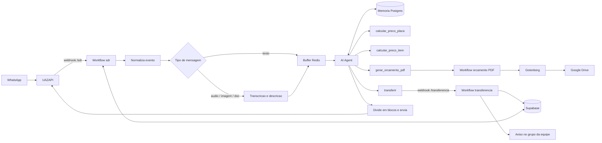

# Agente SDR de WhatsApp com IA


Agente de atendimento e pré-vendas no WhatsApp que conversa como uma pessoa, cota produtos com regras de negócio determinísticas, gera orçamento em PDF e passa o cliente para um humano na hora certa.

> **Projeto de demonstração.** A empresa "Sinaliza Pro", os preços, contatos e dados deste repositório são **fictícios**.
>
> **English summary:** WhatsApp sales-assistant built with n8n, an LLM agent with tool calling, Supabase (Postgres) and Redis. It handles text, audio and image messages, quotes products through deterministic JavaScript pricing tools (the LLM never does the math), generates PDF proposals, and hands the conversation off to a human with an automatic pause/resume mechanism.



## Destaques técnicos

| Desafio | Como foi resolvido |
|---|---|
| O LLM não pode inventar preço | Os valores saem de ferramentas em JavaScript (`calcular_preco_placa` e `calcular_preco_item`). O prompt proíbe o agente de calcular ou somar, e o PDF recalcula tudo no servidor sem aceitar valores vindos do agente. |
| Clientes mandam várias mensagens seguidas | Buffer no Redis com espera e checagem da última mensagem antes de acionar o agente (debounce). |
| Áudio, imagem e documento | Roteamento por tipo: transcrição de áudio, descrição de imagem com modelo de visão e extração de texto de PDF. |
| Resposta com cara de gente, não de robô | Texto dividido em blocos curtos, atraso de digitação proporcional ao tamanho (limite de 4 s) e regras de tom no prompt. |
| Passar para um humano sem perder contexto | A ferramenta `transferir` envia motivo e resumo a um segundo workflow, que pausa a IA, encerra o follow-up e avisa a equipe em um grupo. |
| A IA não pode atrapalhar o atendente | Mensagens enviadas pela própria API são ignoradas, mensagens digitadas por um humano pausam a IA, e ela volta por frase de encerramento ou após 3 horas. |
| Identificar o contato corretamente | Normalização do JID do WhatsApp (evita IDs `@lid`) e comparação de números com e sem o 9º dígito. |
| Responder sobre o andamento do pedido | O status vem do Supabase e é injetado no prompt a cada conversa. |
| Orçamento profissional | Sub-workflow valida a entrada, monta o HTML da proposta, converte em PDF (Gotenberg), sobe no Google Drive e devolve link e número da proposta. |

## Exemplo de conversa

Ilustrativo, com os valores da tabela fictícia deste repositório:

```
Cliente: Preciso de 9 placas de aço fotoluminescente 55x60 e 9 suportes de madeira de 3 metros

Camila: Então ficou assim: 9 placas de aço fotoluminescente, 55×60 cm, e 9 suportes de madeira de 3 metros.

Posso calcular para você?

Cliente: Pode

Camila: Perfeito!

As 9 placas ficaram R$ 246,00 cada, totalizando R$ 2.214,00. Os 9 suportes de madeira, R$ 121,42 cada, totalizando R$ 1.092,78.

O pedido completo fica em R$ 3.306,78.

Quer que eu formalize isso em um documento de orçamento em PDF?
```

## Arquitetura



## Stack

n8n (3 workflows, 87 nodes) · LLM via OpenRouter/OpenAI com tool calling · Supabase/PostgreSQL · Redis · JavaScript (code nodes) · UAZAPI (WhatsApp) · Gotenberg (HTML para PDF) · Google Drive

## Estrutura do repositório

```
.
├── workflows/
│   ├── sdr.json                        # fluxo principal (webhook → agente → resposta)
│   ├── tool-gerar-orcamento-pdf.json   # sub-workflow: orçamento em PDF
│   └── transferencia.json              # transferência para atendente humano
├── prompts/system-prompt.md            # prompt do agente (legível)
├── sql/
│   ├── schema.sql                      # tabelas do Supabase (inferidas dos nodes)
│   └── seed.sql                        # dados fictícios de teste
├── docs/images/canvas-sdr.png          # visão geral do workflow no n8n
├── .env.example                        # segredos necessários (somente nomes)
└── LICENSE
```

## Como rodar

1. **Banco:** rode `sql/schema.sql` (e, se quiser, `sql/seed.sql`) no SQL Editor do Supabase.
2. **Importe os workflows no n8n**, nesta ordem: `transferencia`, `tool-gerar-orcamento-pdf`, `sdr`.
3. **Crie as credenciais** no n8n (Supabase, Postgres, Redis, OpenAI/OpenRouter, Google Drive) e selecione-as nos nodes. Os workflows foram exportados sem nenhuma credencial.
4. **Ajustes manuais após importar:**
   - No node `gerar_orcamento_pdf` (workflow `sdr`), selecione o sub-workflow importado.
   - No node `transferir`, troque `SEU-N8N.exemplo.com` pela URL do seu n8n.
   - Nos nodes `imageFile/Base64` e `file/Base64`, preencha `openai_apikey` (use uma credencial ou variável, nunca commite a chave).
   - No node `notificaGrupo` (workflow `transferencia`), informe o ID do grupo de WhatsApp da equipe.
   - No node `HTML para PDF (Gotenberg)`, ajuste a URL do seu Gotenberg.
   - Nos nodes do Google Drive, escolha a pasta de destino.
5. **Webhook:** na UAZAPI, aponte o webhook da instância para `https://SEU-N8N/webhook/sdr`.
6. Ative os workflows.

## Limitações e próximos passos

- A tabela de preços está duplicada em três code nodes (`calcular_preco_placa`, `calcular_preco_item` e `Montar orçamento (HTML)`). O próximo passo natural é centralizá-la em uma única fonte, como uma tabela no Supabase ou um sub-workflow compartilhado.
- As funções de preço não têm testes automatizados. Por serem JavaScript puro, são bons candidatos a testes unitários.
- Falta monitoramento de erros e métricas (taxa de transferência para humano, tempo de resposta, custo por conversa).
- Os preços, prazos e limites são valores de exemplo e devem ser trocados pela operação real.

## Licença

[MIT](LICENSE)
